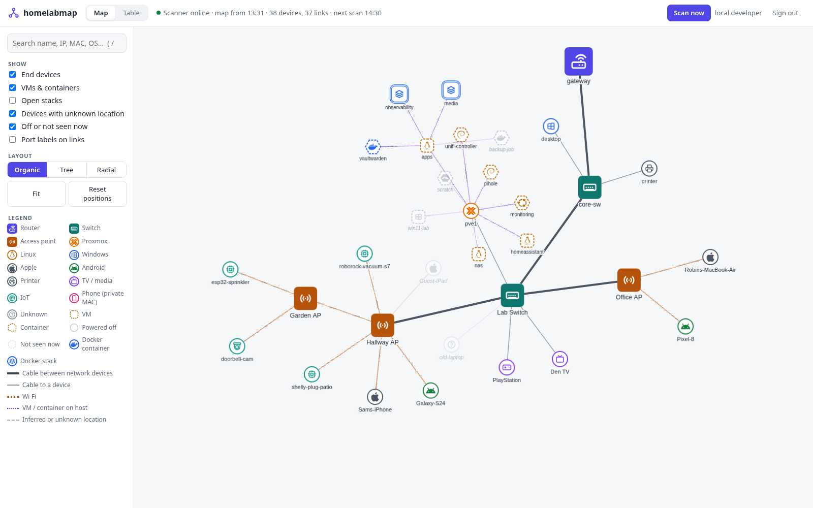

# homelabmap

[](LICENSE)

An automatic topology map of your home lab. homelabmap scans the LAN every
hour, combines what it finds from many sources, and shows it as an
interactive map: network gear, the devices behind each switch port and
access point, VMs and containers on their hosts, and Docker stacks.

<picture>
  <source media="(prefers-color-scheme: dark)" srcset="docs/screenshot-dark.png">
  
</picture>

*The screenshot shows the built-in demo network: `task demo` (or
`go run ./tools/demo`) runs the UI on fictional data, no scanning needed.*

## What it does

* **One map from many sources:** nmap (live hosts, MAC vendors, OS
  fingerprints), SNMP (LLDP, CDP, switch MAC tables, ARP), the UniFi
  controller, Proxmox VE, Cosmos (Docker containers and their routes),
  SSDP/UPnP, reverse DNS, and passive ARP/IPv6 neighbour discovery.
* **Identity by MAC address**, so devices on DHCP keep their place and
  history when their address changes.
* **Every device placed:** on its switch port, under its access point, on its
  hypervisor, or marked as inferred when only a MAC table hints at it.
* **OS icons:** Linux distributions, Windows, Apple, Android, Proxmox, TVs,
  consoles, printers, cameras, smart-home gadgets.
* **History:** devices that are off or gone stay on the map, greyed out, as
  "not seen since …"; phones that rotate private MAC addresses stay one
  device.
* **New devices appear within a minute:** the scanner listens for ARP and
  neighbour discovery and probes anything it hasn't seen before.
* **Table view** of everything (devices, containers, links, what was heard,
  scan history) with sorting and CSV export.
* **Built for a home lab's security:** login via your OpenID Connect
  provider (PKCE), a scanner that listens on no port and runs with only
  raw-socket rights, read-only credentials. See [SECURITY.md](SECURITY.md).

## Quick start (Docker Compose)

You need a Linux host on the LAN you want to map, Docker with Compose, an
OpenID Connect provider (Authentik, Keycloak, Authelia, …) and an HTTPS
reverse proxy.

1. **Create an OIDC client** at your identity provider: authorization code
   flow, public client (PKCE) or confidential, with these redirect URIs:

   ```
   https://homelabmap.example.net/auth/callback
   https://homelabmap.example.net/signin?signed-out=1
   ```

2. **Configure:**

   ```sh
   curl -O https://raw.githubusercontent.com/liorokman/homelabmap/main/compose.yaml
   curl -o .env https://raw.githubusercontent.com/liorokman/homelabmap/main/.env.example
   openssl rand -hex 32      # paste as HOMELABMAP_AGENT_TOKEN
   $EDITOR .env              # public URL, OIDC client, subnets, credentials
   ```

3. **Start it:** `docker compose up -d`, and point your reverse proxy at
   `127.0.0.1:8080`. The first scan starts right away and takes a minute or
   two.

The two images are `ghcr.io/liorokman/homelabmap-web` and
`ghcr.io/liorokman/homelabmap-scanner`.

## Data sources and credentials

Every source is optional except the nmap sweep; the more you configure, the
better the map. Give homelabmap read-only access only.

### SNMP

Switches, routers, Linux hosts (net-snmp) and printers. Set
`HOMELABMAP_SNMP_COMMUNITY` to a read-only v2c community, or use SNMPv3:
`HOMELABMAP_SNMP_VERSION=3`, `HOMELABMAP_SNMP_USER`, and optionally
`HOMELABMAP_SNMP_AUTH_PROTO`/`_AUTH_PASS`/`_PRIV_PROTO`/`_PRIV_PASS`.

### UniFi

Wi-Fi clients and their access points, wired clients on UniFi switches,
device aliases, and recently disconnected clients. Create an API key on the
UniFi OS console (Settings → Control Plane → Integrations) and set
`HOMELABMAP_UNIFI_URL` and `HOMELABMAP_UNIFI_API_KEY`. Other sites than
`default`: `HOMELABMAP_UNIFI_SITE`.

### Proxmox service account

VMs and containers with their MAC addresses, so they appear on their host,
with their status. Create a dedicated read-only user and API token on any
cluster node (as root):

```sh
# 1. A user that only exists for homelabmap
pveum user add homelabmap@pve --comment "homelabmap (read-only)"

# 2. Read-only access to everything: nodes, VMs, containers
pveum acl modify / --users homelabmap@pve --roles PVEAuditor

# 3. An API token for it; the token shares the user's (read-only) rights
pveum user token add homelabmap@pve scanner --privsep 0
```

The last command prints the token's secret **once**. Set:

```
HOMELABMAP_PVE_URL=https://pve.example.net:8006
HOMELABMAP_PVE_TOKEN_ID=homelabmap@pve!scanner
HOMELABMAP_PVE_TOKEN_SECRET=<the secret>
```

* **VM IP addresses** come from the QEMU guest agent, which `PVEAuditor`
  doesn't cover. To include them, also give the user the guest-agent audit
  privilege: on Proxmox VE 9, a role with `VM.GuestAgent.Audit`; on older
  versions, `VM.Monitor`. For example on PVE 9:

  ```sh
  pveum role add HomelabmapGuestAgent --privs VM.GuestAgent.Audit
  pveum acl modify /vms --users homelabmap@pve --roles HomelabmapGuestAgent
  ```

  Without it, VMs are still shown, placed by MAC; container IPs don't need it.
* **Token privilege separation:** with `--privsep 1` instead, the token gets
  no rights of its own; grant the same roles to the token
  (`--tokens 'homelabmap@pve!scanner'`) instead of the user.
* **Self-signed certificate:** set `HOMELABMAP_PVE_INSECURE_TLS=true`, or
  better, give the node a certificate your host trusts.

The same steps work in the web UI under Datacenter → Permissions (Users,
API Tokens, Permissions → Add → User/API Token Permission).

### Cosmos (optional)

If you run [Cosmos](https://cosmos-cloud.io), its Docker containers and
reverse-proxy routes appear under their host. The token needs **only**
"Resources Read" (20) and "Configuration Read" (30), restricted to the
scanner host's IP. The Cosmos UI's "read only" token also grants user and
log access; narrow it through the API with an admin token:

```sh
curl -X PUT -H "Authorization: Bearer $COSMOS_ADMIN_TOKEN" -H 'Content-Type: application/json' \
  -d '{"permissions":[20,30],"ipWhitelist":["192.0.2.10/32"]}' \
  https://cosmos.example.net/cosmos/api/api-tokens/homelabmap
```

Configuration Read exposes Cosmos's whole configuration to the token holder,
including private keys; homelabmap keeps only the routes. Drop it (`[20]`)
to show containers without links. Set `HOMELABMAP_COSMOS_URL` and
`HOMELABMAP_COSMOS_TOKEN`.

## Configuration reference

All settings are environment variables; `.env.example` has the common ones.

**Web** (`homelabmap-web`)

| Variable | Default | |
|---|---|---|
| `HOMELABMAP_PUBLIC_URL` | (required) | URL users open; must be `https` with login |
| `HOMELABMAP_AGENT_TOKEN` | (required) | shared with the scanner, ≥ 32 characters |
| `HOMELABMAP_OIDC_ISSUER`, `_CLIENT_ID` | (required) | OpenID Connect provider and client |
| `HOMELABMAP_OIDC_CLIENT_SECRET` | | confidential clients only |
| `HOMELABMAP_OIDC_ALLOWED_GROUPS` | any | comma-separated `groups` claim values |
| `HOMELABMAP_OIDC_PROVIDER_NAME` | | "Sign in with …" label |
| `HOMELABMAP_OIDC_SCOPES` | `openid profile email` | |
| `HOMELABMAP_SCAN_INTERVAL` | `1h` | full scan interval |
| `HOMELABMAP_RETENTION` | `336h` | scan history kept |
| `HOMELABMAP_FORGET_AFTER` | `720h` | absent devices leave the map after this |
| `HOMELABMAP_OS_RESCAN` | `168h` | re-fingerprint a device at most this often |
| `HOMELABMAP_OS_SCAN_MAX` | `48` | OS fingerprints per scan |
| `HOMELABMAP_PROBE_MAX_PER_HOUR` | `30` | quick scans of new devices; `0` disables |
| `HOMELABMAP_SESSION_TTL` | `12h` | login session lifetime |
| `HOMELABMAP_DB` | `/data/homelabmap.db` | SQLite database |
| `HOMELABMAP_LISTEN`, `_AGENT_LISTEN` | `:8080`, `:8081` | UI and scanner API |
| `HOMELABMAP_INSECURE_NO_AUTH` | `false` | development only; loopback UI only |

**Scanner** (`homelabmap-scanner`)

| Variable | Default | |
|---|---|---|
| `HOMELABMAP_SUBNETS` | (required) | e.g. `192.168.1.0/24`, comma-separated |
| `HOMELABMAP_AGENT_TOKEN` | (required) | same as the web's |
| `HOMELABMAP_SERVER` | `http://127.0.0.1:8097` | the web's scanner API |
| `HOMELABMAP_SNMP_*` | v2c | see [SNMP](#snmp); also `_SEEDS`, `_TIMEOUT` (`1.5s`), `_RETRIES` (`1`), `_CONCURRENCY` (`48`) |
| `HOMELABMAP_UNIFI_*` | | `_URL`, `_API_KEY`, `_SITE` (`default`), `_INSECURE_TLS`, `_HISTORY_HOURS` (`720`) |
| `HOMELABMAP_PVE_*` | | `_URL`, `_TOKEN_ID`, `_TOKEN_SECRET`, `_INSECURE_TLS` |
| `HOMELABMAP_COSMOS_*` | | `_URL`, `_TOKEN`, `_INSECURE_TLS` |
| `HOMELABMAP_PASSIVE` | `true` | listen for ARP/neighbour discovery |
| `HOMELABMAP_SSDP` | `true` | UPnP discovery |
| `HOMELABMAP_JOB_TIMEOUT` | `15m` | longest scan |

## How the map is built

* **Identity is the MAC address**, never the IP. Every source's records are
  merged by union-find over MACs.
* **Cables** come from LLDP and CDP (both ends merged) and UniFi uplinks
  (including wireless mesh). Port names are normalised (`gi1` ↔
  `GigabitEthernet1`) and LAG members are folded into their aggregate.
* **End devices** are placed on the switch port where their MAC is learned on
  a non-uplink port (the quietest port wins). Wi-Fi clients go under their
  access point (UniFi). MACs seen only on uplinks toward a device without a
  MAC table are *inferred* to be behind it (dashed line). MACs on a
  hypervisor's port are its guests; Proxmox data makes that exact.
* **OS** is the strongest of: Proxmox guest type / UniFi device > SNMP
  `sysDescr` > SSDP self-description for appliances (TVs, consoles, NAS) >
  nmap fingerprint > hostname patterns > MAC vendor > randomized Wi-Fi MAC.
  nmap fingerprints only devices whose OS is still a guess.
* **Names**, best first: UniFi device name, the alias set in UniFi,
  Proxmox/SNMP names, the SSDP friendly name, the DHCP hostname, LLDP/CDP,
  reverse DNS.
* **Secondary MACs:** a MAC seen only in other devices' tables that matches
  an answering device's MAC in the first five bytes (after clearing the
  locally administered bit) belongs to it: bond members and bridge- or
  bond-derived addresses.
* **Rotating private MACs:** devices whose MACs are all private and that
  share a specific name are one device; earlier MACs are listed on it.
  Generic names ("iPhone") never link, nor do two such devices present at
  the same time.
* **Absent devices:** devices from the previous map that a scan didn't see,
  and named clients from the UniFi controller's history, stay on the map
  greyed out until unseen for `HOMELABMAP_FORGET_AFTER`.
* Raw observations are stored with each scan, so improved inference rebuilds
  stored maps on upgrade without rescanning.

### New devices between scans

The scanner runs `homelabmap-listen` on the LAN interface: AF_PACKET sockets
for ARP and IPv6 neighbour discovery (BPF-filtered). A MAC never seen before
gets a **probe**: a quick scan of just that device (ARP ping, OS
fingerprint, reverse DNS, fresh UniFi and Proxmox data), merged into the
current map within a minute. A new *wired* device gets its switch port at
the next full scan. The listener hears what reaches the scanner host's port:
broadcast ARP from everyone, but traffic between other hosts only if
switches flood it.

### Device quirks handled

* **Cisco small-business switches (some firmware):** the LLDP management
  address table truncates or drops addresses (shown as a data-quality
  warning); the Q-BRIDGE MAC table index carries an extra length octet; LLDP
  advertises short port names.
* **Some UniFi switches:** LLDP capabilities sent in the second of two octets.
* **Small UniFi switches and APs:** no MAC table over SNMP; placement is
  inferred or comes from UniFi.
* **Routers that speak CDP:** CDP can give the only usable address for a link
  whose LLDP address is broken.

## Architecture

| | `homelabmap-scanner` | `homelabmap-web` |
|---|---|---|
| Job | observe: nmap, SNMP, UniFi, Proxmox, Cosmos, SSDP, DNS, passive listening | schedule, store, infer topology, UI, login |
| Network | host network (needs the LAN segment) | container network |
| Listens | nothing | `:8080` UI, `:8081` scanner API (publish on loopback only) |
| Privileges | non-root; `NET_RAW` + `NET_ADMIN`, held only by `nmap` and the listener | non-root, none |

The scanner long-polls the web for jobs and posts results back (bearer token,
gzip JSON).

```
cmd/homelabmap-scanner  cmd/homelabmap-web  cmd/homelabmap-listen
internal/obs       wire format between scanner and web
internal/scanner   collectors: nmap, SNMP, UniFi, Proxmox, Cosmos, SSDP, DNS; probes; passive watch
internal/sniff     ARP/NDP frame parsing, AF_PACKET listener
internal/topo      inference: entities by MAC, links, placement, OS, history
internal/store     SQLite (pure Go), migrations
internal/web       HTTP, OIDC + PKCE, scheduler, scanner API, embedded UI
tools/demo         the demo network
```

## Development

Requires Go (see `go.mod`) and [Task](https://taskfile.dev).

```sh
task demo          # the UI on fictional data: http://127.0.0.1:8090
task check         # go vet, golangci-lint, tests with coverage (≥ 80%)
task test          # tests with the race detector
task lint:install  # the pinned golangci-lint
task build         # binaries in out/
task images        # both images for this machine
```

The image build runs the test suite too. Without root, nmap sees no MACs and
can't fingerprint; to try the real scanner, run its image with
`--network host --cap-drop ALL --cap-add NET_RAW --cap-add NET_ADMIN`
(`-once` prints one result as JSON).

Publishing images: `task push VERSION=x.y.z` builds both images and pushes
them with `crane` to `$HOMELABMAP_IMAGE_PREFIX-{web,scanner}`
(`ghcr.io/liorokman/homelabmap-…` by default; log in to the registry first).

### Deploying on Cosmos

`deploy/cosmos-compose.json` is a Cosmos-Compose template. `task render`
fills it from `.env` (including `HOMELABMAP_HOST`, `HOMELABMAP_LAN_CIDR` and
`HOMELABMAP_DATA_VOLUME`) into `deploy/cosmos-compose.rendered.json`, which
you import in Cosmos (ServApps → Import Compose) or post to its
`/cosmos/api/docker-service` endpoint.

## License

[Apache License 2.0](LICENSE). Third-party components: Cytoscape.js and its
fcose layout (MIT, see `internal/web/static/vendor/LICENSES.txt`); icons
generated by `tools/genicons.py` from Tabler Icons (MIT) and Simple Icons
(CC0-1.0).
